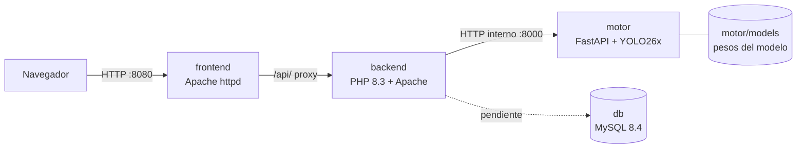

# Detector de objetos en video

Aplicación web para subir un video y saber **qué objetos aparecen en él**, **cuántos hay** y **en qué momentos** aparecen. El video se analiza por frames: el navegador extrae imágenes a la frecuencia elegida y cada imagen se envía a un motor de inteligencia artificial basado en **YOLO** (Ultralytics), que devuelve la clase y la caja de cada objeto encontrado.

El resultado se muestra en dos vistas:

- **Conteo:** máximo de objetos visibles a la vez por tipo, apariciones totales y primer/último instante en que aparece cada tipo.
- **Reporte:** una fila por cada objeto detectado, con su instante de tiempo, clase y confianza.

Modelo actual: **YOLO26x** (`yolo26x.pt`), el más grande de la familia YOLO26 disponible en Ultralytics, preentrenado con las 80 clases de COCO.

---

## Documentación por sección

| Sección | Documento | Contenido |
|---|---|---|
| Interfaz web | [`frontend/README.md`](frontend/README.md) | Disposición de la página, flujo de análisis, ajustes y archivos |
| API de entrada | [`backend/README.md`](backend/README.md) | Endpoints `health` y `detect`, campos reenviados y códigos de respuesta |
| Motor de IA | [`motor/README.md`](motor/README.md) | Cómo está armado, selección del modelo, variables de entorno y endpoints |
| Base de datos | [`db/README.md`](db/README.md) | Esquema, usuario de la aplicación y estado actual |

---

## Arquitectura



Las líneas punteadas indican lo que todavía no está conectado (ver [Estado actual](#estado-actual)).

| Servicio | Tecnología | Responsabilidad | Puerto |
|---|---|---|---|
| `frontend` | Apache 2.4 + HTML, CSS y JavaScript sin dependencias | Interfaz; extrae frames con `<video>` y `<canvas>`; hace proxy de `/api/` al backend | `8080` (host) |
| `backend` | PHP 8.3 + Apache | API de entrada única (`services.php?servicio=…`); reenvía las imágenes y ajustes al motor con cURL | interno |
| `motor` | Python 3.12 + FastAPI + Ultralytics YOLO26x (CPU) | Carga el modelo y ejecuta la detección de objetos | `127.0.0.1:8000` (solo local) |
| `db` | MySQL 8.4 | Esquema `imagenes` y `detecciones` (aún no se usa) | interno |

### Flujo de un análisis

1. El usuario agrega videos a la lista de la izquierda y elige uno; se reproduce en el visor central.
2. En el panel de la derecha ajusta los fps, el máximo de frames, la confianza, el IoU, el tamaño de análisis y las clases.
3. Al pulsar **Analizar video**, el frontend captura un frame por cada instante y lo envía a `POST /api/services.php?servicio=detect`, hasta 4 peticiones en paralelo.
4. El backend valida la subida y la reenvía a `POST http://motor:8000/detect` junto con los ajustes.
5. El motor ejecuta YOLO26x y responde con las detecciones.
6. El frontend descarta las detecciones por debajo de la confianza elegida, agrega los resultados por frame y muestra conteo, descripción y reporte.

### Estructura del repositorio

```
detector_objetos_video/
├── docker-compose.yml      # orquestación de los 4 servicios
├── README.md               # este documento
├── .gitignore
├── frontend/
│   ├── README.md
│   ├── Dockerfile          # httpd:2.4-alpine + public/
│   ├── httpd.conf          # sirve public/ y hace proxy /api/ -> backend
│   └── public/
│       ├── index.html
│       ├── css/styles.css
│       └── js/app.js       # biblioteca, análisis de frames y presentación
├── backend/
│   ├── README.md
│   ├── Dockerfile          # php:8.3-apache + src/
│   └── src/services.php    # punto de entrada: health y detect
├── motor/
│   ├── README.md
│   ├── Dockerfile          # python:3.12-slim + torch CPU + ultralytics
│   ├── requirements.txt    # dependencias fijadas
│   ├── app/main.py         # API de inferencia
│   └── models/             # pesos del modelo (volumen; no se versionan)
└── db/
    ├── README.md
    ├── Dockerfile          # mysql:8.4 + init.sql
    └── init.sql            # esquema de la base de datos
```

---

## Puesta en marcha

Requisitos: Docker y Docker Compose v2, y conexión a internet la primera vez (imágenes base, PyTorch y pesos del modelo).

```bash
docker compose up --build
```

- Interfaz web: http://localhost:8080
- Motor (solo pruebas locales): http://127.0.0.1:8000/health

El backend solo arranca cuando el motor está **healthy**. La primera vez tarda más: se instala PyTorch y se descarga `yolo26x.pt` (unos 119 MB) al volumen `motor/models/`.

Para comprobar que todo está conectado sin usar la interfaz:

```bash
curl "http://localhost:8080/api/services.php?servicio=health"
# {"backend":"ok","motor":"ok"}
```

---

## Cambiar de modelo

Edita `MODEL_NAME` en `docker-compose.yml` y reinicia el motor con `docker compose up -d motor`. El detalle de modelos disponibles y de pesos propios está en [`motor/README.md`](motor/README.md#selección-del-modelo).

---

## Estado actual

Implementado:

- Interfaz en tres columnas: biblioteca de videos, visor y resultados, y ajustes de detección.
- Análisis configurable: fps, máximo de frames, confianza, IoU, tamaño de entrada y clases.
- Backend con endpoints `health` y `detect`, con timeouts y manejo de errores.
- Motor con detección real usando YOLO26x, con modelo configurable y arranque tolerante a fallos.
- Orquestación con Docker Compose, healthchecks y red interna.

Pendiente:

- **Persistencia:** el backend no escribe en MySQL; el esquema existe pero no se usa.
- **Credenciales:** las contraseñas de MySQL están en `docker-compose.yml` y `init.sql`. Para producción deben moverse a variables de entorno o secretos.
- **Pruebas automatizadas:** no hay tests todavía.
- **Frontend:** `esperarEvento` puede quedarse esperando el evento `seeked` si el instante solicitado coincide con la posición actual del video.
